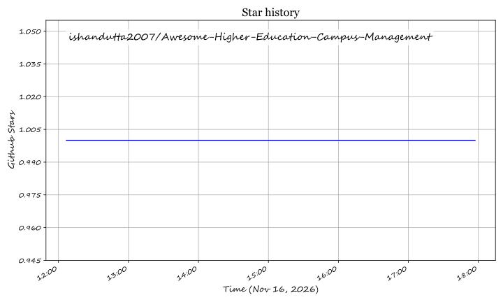

<div align="center">

<a href="https://github.com/ishandutta2007/Awesome-Awesome-Awesome"></a>
<a href="https://discord.gg/jc4xtF58Ve"></a>
<a href="https://github.com/ishandutta2007/Awesome-Higher-Education-Campus-Management/stargazers"></a>
<a href="https://github.com/ishandutta2007/Awesome-Higher-Education-Campus-Management/network/members"></a>
<a href="https://github.com/ishandutta2007/Awesome-Higher-Education-Campus-Management/blob/main/LICENSE"></a>
<a href="https://github.com/ishandutta2007"></a>

<br/><br/>

<a href="https://github.com/ishandutta2007/Awesome-Higher-Education-Campus-Management">
  
</a>

# Awesome Higher Education & Campus Management 🎓🏛️

**A curated index of SaaS platforms, enterprise ERP systems, and open-source Student Information Systems (SIS) for colleges, universities, and academic institutions.**

[](https://github.com/ishandutta2007/Awesome-Higher-Education-Campus-Management/pulls)
[](https://github.com/ishandutta2007/Awesome-Higher-Education-Campus-Management/graphs/commit-activity)
[](https://github.com/ishandutta2007/Awesome-Higher-Education-Campus-Management/commits/main)

</div>

---

## 📌 Executive Summary & Introduction

Welcome to **Awesome Higher Education & Campus Management**, an authoritative, community-driven guide to software solutions modernizing tertiary education administration. Whether you are an academic registrar evaluating multi-million dollar enterprise Student Information Systems (SIS), an IT director seeking self-hosted open-source campus ERP alternatives to evade recurring per-student SaaS fees, or an EdTech developer designing interoperable campus tools, this repository catalogs the premier solutions across the globe.

Higher education institutions face unique software infrastructure challenges: managing student records under strict privacy legislation (FERPA, GDPR, HIPAA), coordinating complex academic scheduling across faculties, overseeing bursar billing and financial aid, and ensuring continuity across multi-campus networks. This repository delivers clear, empirical insight into **platform features, transparent starting tier pricing, free tier/trial realities, company valuations, and open-source community traction.**

---

## 📑 Table of Contents
- [📊 Sector Overview & Market Dynamics](#-sector-overview--market-dynamics)
- [🏢 SaaS & Hosted Commercial Platforms](#-saas--hosted-commercial-platforms)
- [💻 Open-Source GitHub Projects & Self-Hosted SIS](#-open-source-github-projects--self-hosted-sis)
- [📈 Star History](#-star-history)
- [🤝 Support & Sponsorship](#-support--sponsorship)
- [🤝 How to Contribute](#-how-to-contribute)
- [⚖️ Disclaimer & Compliance](#️-disclaimer--compliance)

---

## 📊 Sector Overview & Market Dynamics

The global higher education campus management and education enterprise resource planning (ERP) market is valued between **$6.5 Billion and $16.5 Billion**, with forecasts projecting robust compound annual growth rates (**CAGR of 11% to 21%**) exceeding **$35 Billion** in the 2030s.

```
┌────────────────────────────────────────────────────────────────────────┐
│                   MARKET ARCHITECTURE & LANDSCAPE                      │
├────────────────────────────────────┬───────────────────────────────────┤
│    CONCENTRATED ENTERPRISE CORE    │       MODERATELY FRAGMENTED       │
│           (Oligopoly)              │             PERIPHERY             │
│  - Heavy switching costs (>5-10 yr)│  - Rapidly expanding ecosystem    │
│  - Multi-year enterprise contracts │  - Departmental point solutions   │
│  - Anchors: Workday, Ellucian,     │  - Niche CRMs, scheduling bots,   │
│    Anthology, Oracle PeopleSoft    │    advising tools, & self-hosted  │
│                                    │    open-source SIS engines        │
└────────────────────────────────────┴───────────────────────────────────┘
```

The sector demonstrates a distinct **bimodal market structure**:
1. **The Concentrated Core (Oligopoly):** At the institutional level for R1 research universities, statewide college systems, and four-year universities, the market is heavily consolidated. A handful of entrenched enterprise vendors (Workday, Ellucian Banner/Colleague, Anthology Blackboard, and Oracle) maintain deep competitive moats due to extreme switching costs, complex regulatory workflows, and custom multi-year implementations.
2. **The Fragmented Periphery:** Surrounding this core is an active, fragmented ecosystem of departmental SaaS products and point solutions addressing admissions CRMs, academic advising, financial aid disbursement, alumni relations, and student retention analytics. Simultaneously, an increasingly robust open-source movement (led by Frappe Education, Odoo Education, RosarioSIS, and openSIS) offers institutions full data sovereignty and relief from escalating licensing budgets.

---

## 🏢 SaaS & Hosted Commercial Platforms

*Enterprise campus management systems sorted in descending order by company scale, valuation, and market capitalization.*

| Product | Company Scale (Revenue / Valuation) | Pricing (Starting) | Free Tier / Trial Limits | Description |
|:---|:---|:---|:---|:---|
| **[Workday Student](https://www.workday.com/)** | ~$10.1B revenue / ~$46B–$47B market cap | Starting from ~$100–$504/employee/year for base enterprise tier (custom institutional contract) | 0-day public trial (No free tier or open trial; custom scheduled enterprise sandbox / sales demo only) | **HCM and Student integrated on one unified cloud platform.** Built for large university systems to streamline admissions, student records, financial aid, and workforce analytics under one database. |
| **[PowerSchool SIS](https://www.powerschool.com/)** | ~$700M+ revenue / $5.6B valuation (acquired by Bain Capital) | Starting from ~$9–$20/student/year (district/institution contract scale) | 0-day public trial (No free tier or public trial; custom institution-scoped sales demo only) | **Leading SIS with higher education & K-12 capabilities.** Comprehensive gradebook, enrollment records, transcripts, state reporting, and automated parent/student portals. |
| **[Ellucian Banner](https://www.ellucian.com/)** | ~$500M–$800M+ revenue / ~$5B+ valuation (Blackstone / Vista Equity) | Starting from ~$30,000–$50,000/year for smaller deployments (enterprise multi-year contracts) | 0-day public trial (No free tier or public trial; scheduled sales demonstration only) | **The enterprise standard for higher education ERP.** Mission-critical Student Information System handling degree audits, bursar billing, curriculum management, and institutional research. |
| **[Anthology (Blackboard)](https://www.anthology.com/)** | ~$450M revenue / PE-backed (Blackstone / Veritas) | Starting from ~$9,500/year for baseline institutional licensing | 0-day public trial (No self-service free tier or open trial; 30-day promotional pilot/demo via sales request) | **Comprehensive EdTech suite combining SIS, CRM, and LMS.** Modular higher education ecosystem connecting academic advising and student lifecycle data with Blackboard Learn. |
| **[Jenzabar](https://www.jenzabar.com/)** | ~$110M revenue / Privately held | Starting from ~$15,000–$25,000/year for specialized modular deployments | 0-day public trial (No free tier or public trial; interactive demo environment available on request) | **Higher education ERP and SIS tailored for private colleges and universities.** Modular suite covering admissions workflows, registration, tuition management, and institutional advancement. |
| **[Classe365](https://www.classe365.com/)** | ~$5M–$15M estimated revenue / Privately held | Starting at $100/month (Core plan up to 100 active students; billed monthly/annually) | 14-day free trial (Full feature access capped to sandbox student database, no credit card required) | **Modern unified SIS, CRM, and LMS cloud platform.** Tailored for vocational colleges, small universities, and academies with self-serve student and parent portals. |
| **[openSIS Cloud](https://opensis.com/)** | Bootstrapped / OS4ED (~$2M–$5M estimated revenue) | Starting at $4–$5/user/month (Core staff tier billed annually) | 15-day free trial (Unlimited modules for trial period; free tier available post-trial with community feature limits) | **Hosted SaaS edition of openSIS.** Managed cloud deployment eliminating self-hosting overhead for student scheduling, demographics, and grade tracking. |
| **[Gradelink](https://www.gradelink.com/)** | ~$1M–$10M estimated revenue / Privately held | Starting at $117–$121/month (Tier covering up to 50 active students, plus initial onboarding fee) | Flexible demo trial (Guided trial sandbox populated with sample student data arranged via sales advisor) | **Streamlined SIS and administrative system.** Popular with private institutes, trade schools, and colleges for attendance, tuition billing, and transcripts. |

---

## 💻 Open-Source GitHub Projects & Self-Hosted SIS

*Self-hosted student information systems, academic ERPs, and learning portals sorted in descending order by GitHub_Stars.*

| Project | Stars_Badge | Description |
|:---|:---:|:---|
| **[Odoo Education](https://github.com/odoo/odoo)** | [](https://github.com/odoo/odoo/stargazers) | **Comprehensive enterprise management suite with dedicated education modules.** **LGPL-3.0**, Python/JavaScript/PostgreSQL. Covers student admission, enrollment registers, timetables, course structures, faculty management, and integrated accounting/payroll. Best for institutions seeking complete campus ERP unification. |
| **[ERPNext Education Module](https://github.com/frappe/erpnext)** | [](https://github.com/frappe/erpnext/stargazers) | **Enterprise ERP ecosystem containing integrated higher education workflows.** **GPL-3.0**, Python/Frappe framework. Handles student onboarding, academic terms, programs, attendance tracking, fees, examinations, and fee collection linked directly to core General Ledger and procurement. |
| **[Open edX Platform](https://github.com/openedx/edx-platform)** | [](https://github.com/openedx/edx-platform/stargazers) | **The flagship open-source learning and course management platform used by leading global universities.** **AGPL-3.0**, Python/Django. Delivers scalable course delivery, student progress analytics, automated grading, cohort management, and discussion forums for large-scale campus online learning. |
| **[OpenEduCat](https://github.com/openeducat/openeducat_erp)** | [](https://github.com/openeducat/openeducat_erp/stargazers) | **Open-source ERP tailored specifically for universities and educational institutions.** **LGPL-3.0**, Python/Odoo foundation. Features student enrollment, campus infrastructure booking, faculty management, academic schedules, examination grading, student finance, and alumni networks. |
| **[Frappe Education](https://github.com/frappe/education)** | [](https://github.com/frappe/education/stargazers) | **Dedicated campus & academic management system built on the Frappe Framework.** **GPL-3.0**, Python/MariaDB. Provides student and guardian portals, course scheduling, admissions workflows, assessment centers, and fee payment processing. Built to operate either standalone or with ERPNext. |
| **[RosarioSIS](https://github.com/francoisjacquet/rosariosis)** | [](https://github.com/francoisjacquet/rosariosis/stargazers) | **Modular open-source Student Information System with tight LMS integration.** **GPL-2.0**, PHP/PostgreSQL/MySQL. Includes 10 core administrative modules (attendance, gradebooks, discipline, student billing, food service, hostel management) alongside a bi-directional Moodle connector and automated PDF generation. |
| **[Gibbon](https://github.com/GibbonEdu/core)** | [](https://github.com/GibbonEdu/core/stargazers) | **Modular school & campus operations platform.** **GPL-3.0**, PHP. Features student records, timetable planners, admissions, and faculty management. Highly extensible via specialized community add-ons like Higher Education Applications, Alumni Tracking, and BigBlueButton video integration. |
| **[jobic10 Student Management](https://github.com/jobic10/student-management-using-django)** | [](https://github.com/jobic10/student-management-using-django/stargazers) | **Full-featured academic and student administration application.** **MIT licensed**, Python/Django/PostgreSQL. Provides course registration, add/drop workflows, lecturer allocations, GPA/assessment calculation, fee tracking, and multi-role dashboards for students, staff, and registrars. |
| **[openSIS Classic](https://github.com/OS4ED/openSIS-Classic)** | [](https://github.com/OS4ED/openSIS-Classic/stargazers) | **Established open-source Student Information System for multi-institution setups.** **GPL-2.0**, PHP/MySQL. Core capabilities include student demographics, master scheduling, transcripts, attendance, teacher gradebooks, disciplinary records, and parent/student portals. Available via Docker for quick deployment. |
| **[ProjectsAndPrograms School Management](https://github.com/ProjectsAndPrograms/school-management-system)** | [](https://github.com/ProjectsAndPrograms/school-management-system/stargazers) | **Web-based campus and school management system.** PHP/MySQL. Features dedicated role portals for administrators, instructors, and students, with support for timetable scheduling, attendance logging, fee receipts, and exam report generation. |
| **[College-ERP](https://github.com/Ansarimajid/College-ERP)** | [](https://github.com/Ansarimajid/College-ERP/stargazers) | **Campus Enterprise Resource Planner tailored for engineering and degree colleges.** Python/Django. Covers student profiles, faculty assignment, course syllabi, timetable slots, internal marks assessment, and attendance recording with role-based access control. |
| **[Django Student Management System](https://github.com/Akash1362000/Django_Student_Management_System)** | [](https://github.com/Akash1362000/Django_Student_Management_System/stargazers) | **Modern student information and campus admin portal.** Python/Django. Offers interactive dashboards for staff and students, leave approval workflows, course enrollment, attendance tracking, and semester examination results. |

---

## 📈 Star History

[](https://www.star-history.com/#ishandutta2007/Awesome-Higher-Education-Campus-Management&type=date&legend=top-left)

---

## 💖 Support & Sponsorship

Thank you for exploring and utilizing **Awesome Higher Education & Campus Management**! Maintaining this repository, researching software licensing, monitoring market consolidations, and testing open-source deployments requires ongoing dedication.

If you find this resource valuable to your research, institution, or project:
- 🌟 **Star** this repository on GitHub to help others discover it.
- 🍴 **Fork** it and submit pull requests to keep the database up-to-date.
- 📢 **Share** this list with colleagues, IT administrators, academic registrars, and EdTech developers.
- ☕ **Buy a Coffee / Sponsor**: Consider backing ongoing maintenance and research via the [GitHub Sponsors Dashboard](https://github.com/sponsors/ishandutta2007).

Your support is deeply appreciated! 🚀

---

## 🤝 How to Contribute

Contributions are warmly welcome! We invite registrars, systems engineers, educators, and maintainers to help expand this list:

1. **Fork the Repository** to your own GitHub profile.
2. **Review Formatting**: Follow existing table schemas.
   - For **SaaS platforms**: Include product name, official link, verified company scale, starting price tier, and specific free trial/tier day limits.
   - For **Open-Source projects**: Include official repository link, white social Stars_Badge linked to `/stargazers`, and factual technical description.
3. **Submit a Pull Request (PR)** with a concise summary of the additions or updates.

Please ensure all submissions adhere to neutral, factual assessments without promotional hyperbole.

---

## ⚖️ Disclaimer & Compliance

- This repository is an independent, **community-curated index** created for informational, educational, and benchmarking purposes. It does not constitute formal procurement consulting or vendor endorsement.
- **Data Protection & Privacy**: Higher education platforms handle sensitive student personally identifiable information (PII), academic transcripts, and financial aid records. Implementations must comply with relevant institutional and jurisdiction-specific mandates including **FERPA** (United States), **GDPR** (European Union), **COPPA**, and state-level data privacy regulations.
- **Total Cost of Ownership (TCO)**: Quoted figures reflect base entry rates and public reporting. Institutional procurement involves variables such as full-time equivalent (FTE) headcounts, data migration costs, change management consulting, and third-party database hosting.

---

<div align="center">

**Made with ❤️ for registrars, IT leaders, and educational technologists worldwide.**  
*Empowering academic institutions through transparent, accessible, and high-performance campus software.*

</div>

## ⭐ Star History

<a href="https://star-history.com/#ishandutta2007/Awesome-Higher-Education-Campus-Management&Timeline" align="center">
  <picture>
    <source media="(prefers-color-scheme: dark)" srcset="assets/ishandutta2007_Awesome-Higher-Education-Campus-Management_growth.svg">
    
  </picture>
</a>
